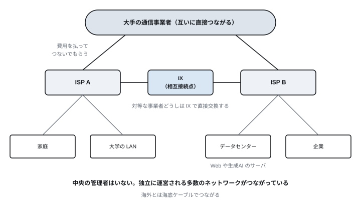
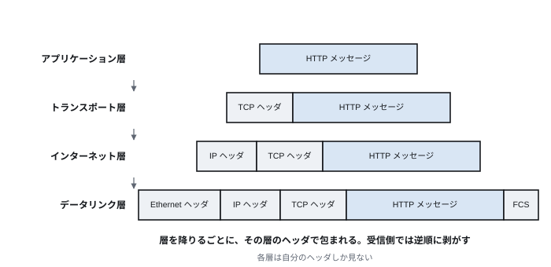
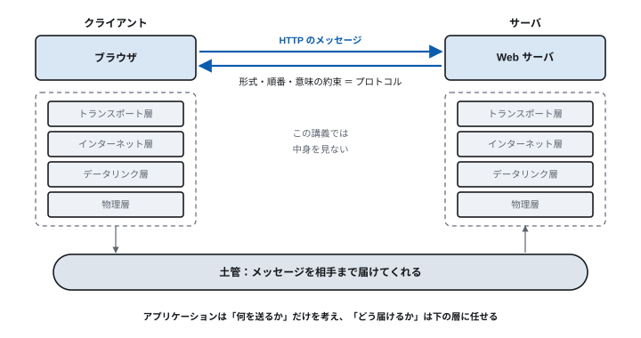
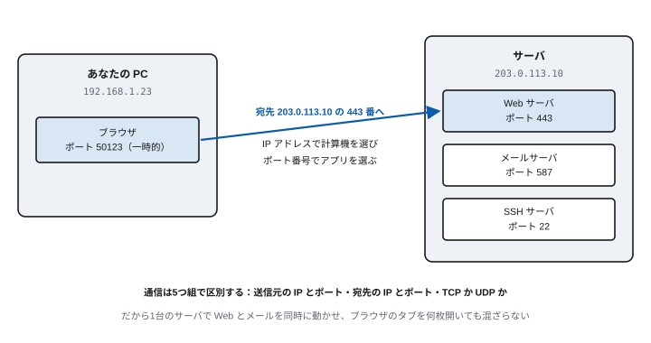

<!-- 通信工学通論　第1回 インターネットとアプリケーション層 -->
<!-- slides/decks/lec01.js から node slides/tools/build-md.js で書き出したもの。
     pptx 版・HTML 版と同じ内容。直すときは decks の側を直して書き出し直す。 -->

<!-- _class: lead -->

通信工学通論

# 第1回　インターネットとアプリケーション層

*普段使っているアプリは、ネットワークの上で何をやりとりしているのか。*

九州大学

---

<!-- ガイダンス -->

## 担当教員

小出 洋（こいで ひろし）　情報基盤研究開発センター　情報システムセキュリティ研究部門

- **研究** — サイバーセキュリティ。Moving Target Defense、攻撃検知と防御、自律型のサイバー防御エージェント
- **CTF** — 学生とチームを組んで参加している
- **教育** — 九州大学で9年目。学生の指導歴は24年になる

> **攻撃者の次の一手を、先に読む**  
> インターネット、Web サービス、AI —— 身近なシステムが攻撃を受けたときに、どうすれば被害を小さくできるのか。

**8回のうち重きを置いているのは第6・7回（LLM と AIエージェント）と第8回（セキュリティ）。他の回も、そこにつながるように並べてある。**

---

<!-- ガイダンス -->

## この講義の全8回

TCP/IP のアプリケーション層を扱う。下の層（トランスポート層以下）は、この講義では中身を見ない。

| 回 | テーマ | 今回の問い |
| --- | --- | --- |
| 第1回 | インターネットとアプリケーション層 | アプリはネットワークの上で何をやりとりしているのか |
| 第2回 | DNS と電子メール | 名前しか知らない相手に、どう届けるのか |
| 第3回 | WWW と HTTP | ページが表示されるまでに何が起きているのか |
| 第4回 | Web アプリケーションと Web API | 状態を持たない HTTP の上で、ログインはどう作るのか |
| 第5回 | クラウド・仮想化・P2P | アプリはどこで動いているのか |
| 第6回 | LLM のしくみと API | LLM は何をしていて、どう使われているのか |
| 第7回 | AIエージェントと MCP | AIエージェントはネットワークの上で何をしているのか |
| 第8回 | セキュリティ | 顔の見えない相手を、どう信用するのか |

---

<!-- ガイダンス -->

## この講義の進め方

90分 × 全8回。各回はこの型で進む。

- **冒頭** — 今回の問い —— この90分で答えを出す1つの問い
- **本体** — 3〜5ブロック。図と、実際に流れるメッセージを見る
- **手を動かす** — 実習かデモを毎回入れる。自分の PC で通信を観察する

> **アプリケーション層のプロトコルの多くは、人が読める文字で書かれている**  
> だから、実際に流れているものを自分の目で見られる。見て確かめることを毎回の基本にする。

**演習の解答は、ポートフォリオと一緒に Moodle で提出してもらう。**

---

<!-- ガイダンス -->

## 提出物・成績評価・出席

提出はすべて Moodle で行う。

|  | 内容 |
| --- | --- |
| 毎回の提出物 | ポートフォリオ と 演習問題の解答 |
| 提出先 | Moodle |
| 締切 | 出題から1週間以内 |
| 成績評価 | 毎回の提出物で付ける |
| 出席 | 提出をもって出席とする |
| 連絡・質問 | Moodle で受け付ける |

> **毎回出すこと。それが成績であり、出席でもある**

教科書・参考書は指定しない。講義資料と演習で完結する。

---

<!-- ガイダンス -->

## ポートフォリオに何を書くか

毎回、次の2点を書いて Moodle に出す。演習問題の解答と一緒に提出する。

- **1. 今回の問いに、自分の言葉で答える** — 各回の冒頭に「今回の問い」が1つ示される。講義の言い回しをなぞるのではなく、自分の言葉に置き換えて書く
- **2. 分からなかったこと** — 「分からなかった」と書いて減点することはない。どこで詰まったかが分かるほうが、次の回の組み立てに活きる

> **8回ぶんが、そのまま自分の学びの記録になる**  
> 8回の答えを並べると、インターネットの構成から AIエージェントとセキュリティまでが一本の線でつながる。最終回に見返してもらう。

**分量は200文字以上。**

---

<!-- _class: lead -->

## 今回の問い

> **普段使っているアプリは、  
ネットワークの上で何をやりとりしているのか。**

ブラウザも、メールも、生成AIも、同じ仕組みの上で動いている。

この90分で、この問いに答えを出す。

---

## 到達目標

1. **インターネットの構成** を「網の網」として説明できる
2. **TCP/IP の階層モデル** の中で、アプリケーション層が受け持つ範囲を説明できる
3. **プロトコル** が何を決めているかを説明できる
4. **IP アドレスとポート番号** の役割の違いを説明できる

---

<!-- _class: lead -->

# 1.1　インターネットで何ができるか

*すでに生活のあらゆるところにある*

---

<!-- 1.1　いま -->

## いまのインターネットでできること

- **生成AI** — ChatGPT、Claude、Gemini に質問し、文章やコードを作らせる
- **動画と音楽の配信** — YouTube、Netflix、Spotify。通信量の大きな部分を動画が占める
- **SNS とメッセージ** — LINE、X、Instagram。写真や短い動画を共有する
- **決済と買い物** — キャッシュレス決済、ネット通販、チケットの予約
- **学習と仕事** — Moodle、オンライン会議、クラウド上の文書の共同編集
- **モノのインターネット** — 家電、自動車、センサがつながり、データを送る

**どれも「アプリケーション」である。この講義は、これらがネットワークの上で何をやりとりしているかを扱う。**

---

<!-- 1.1　いま -->

## 「答える」AI から「動く」AI へ

生成AI は、人の質問に答えるだけの道具から、ネットワーク上のサービスを使って自分で仕事を進める存在に変わりつつある。

> **AI も、この講義で学ぶプロトコルをそのまま使って動いている**

- メールを読んで仕分ける → **電子メール（第2回）**
- Web ページや API を呼ぶ → **HTTP と JSON（第3・4回）**
- 予定をカレンダーに登録する → **Web API と OAuth（第4回）**

第6・7回では、LLM と AIエージェントが何をどうやりとりしているかを、ここまでの知識で読み解く。

---

<!-- 1.1　考えてみよう -->

## 考えてみよう（3分）

今日、起きてから使ったネットワークのサービスを書き出してみる。

- 使ったサービスを5つ挙げる
  - 例：天気予報のアプリ、LINE、Moodle、動画、検索
- それぞれ、相手の計算機はどこにあると思うか
  - 自分のスマートフォンの中か、大学の中か、どこかのデータセンターか
- 通信が止まったら、どのサービスが使えなくなるか

**ほとんどのサービスは、手元ではなく遠くの計算機で動いている。それを可能にしているのがインターネットである。**

---

<!-- _class: lead -->

# 1.2　インターネットの構成

*中央の管理者がいない「網の網」*

---

<!-- 1.2　構成 -->

## インターネットは「網の網」

インターネットは単一の巨大なネットワークではない。独立に運営される多数のネットワークが、互いにつながったものである。



---

<!-- 1.2　構成 -->

## 接続の形と IX

- **トランジット** — 小さな事業者が大きな事業者に費用を払い、インターネット全体へつないでもらう
- **ピアリング** — 対等な事業者どうしが、互いの利用者宛ての通信を交換する
- **IX（相互接続点）** — 多数の事業者が1か所に集まって相互につなぐ拠点。日本では JPIX、JPNAP など

> **IX があると線の数が減る**  
> n 個の事業者が互いに直接つなぐと n(n−1)/2 本の線が要る。IX に集まれば n 本で済む。

**1990年代には、国内どうしの通信が米国を往復していた。IX の整備で、国内の通信は国内で交換できるようになった。**

---

<!-- 1.2　歴史 -->

## インターネットの歩み

1. **1969年** — ARPANET。4拠点の計算機をつなぎ、資源を共有した
2. **1983年** — TCP/IP に切り替わる。網どうしをつなぐ共通の約束ができた
3. **1991年** — WWW の公開。誰でもページを読み書きできるようになる
4. **2007年頃** — スマートフォンの普及。常に持ち歩き、常につながる
5. **2022年** — 生成AI の公開。対話で使え、やがて自分で動くようになる

電子メール、DNS（1984年）、Web —— いま使っているアプリケーションの多くは、この流れの中で生まれた。

---

<!-- _class: lead -->

# 1.3　階層モデルとアプリケーション層

*下の層は、中身を見ない土管として扱う*

---

<!-- 1.3　階層モデル -->

## TCP/IP の階層モデル

通信の仕事を5つの層に分け、各層は自分の仕事だけをする。

| 層 | 役割 | 主なプロトコル | データの呼び名 |
| --- | --- | --- | --- |
| アプリケーション層 | アプリ固有のやりとり | HTTP、DNS、SMTP、SSH | メッセージ |
| トランスポート層 | 端と端の間の通信の品質 | TCP、UDP、QUIC | セグメント |
| インターネット層 | 網をまたぐ中継 | IP、ICMP | パケット |
| データリンク層 | 隣の機器への配送 | Ethernet、Wi-Fi | フレーム |
| 物理層 | ビットを信号にする | ケーブル、電波 | ビット |

> **この講義が扱うのは、一番上のアプリケーション層である**

理論的な7層の OSI 参照モデルも知られているが、実際のインターネットはこの5層で動いている。

---

<!-- 1.3　階層モデル -->

## カプセル化

上の層のデータは、下の層のデータの中身として運ばれる。各層は自分のヘッダを付け加える。



封筒の比喩：手紙を書き、封筒に何通目かを書き、宛先を書き、配送業者の伝票を貼る。

---

<!-- 1.3　アプリケーション層 -->

## アプリケーションから見たネットワーク



---

<!-- 1.3　プロトコル -->

## プロトコルは何を決めているか

プロトコルは、通信する者どうしの約束ごとである。

- **形式** — メッセージの書き方。HTTP なら「GET /index.html HTTP/1.1」のように書く
- **順番** — 誰が先に何を送るか。クライアントが要求し、サーバが応答する
- **意味** — 受け取ったものをどう解釈するか。200 は成功、404 は見つからない

> **アプリケーション層のプロトコルの多くは、人が読める文字で書かれている**  
> HTTP、SMTP、JSON。HTTP/2 以降は2進の形式になったが、運んでいる意味は同じである。

**第2〜4回では、実際に流れている文字を自分の目で見る。**

---

<!-- _class: lead -->

# 1.4　クライアント・サーバとポート番号

*IP アドレスで計算機を、ポート番号でアプリを選ぶ*

---

<!-- 1.4　形 -->

## クライアント・サーバと P2P

### クライアント・サーバ

- 役割が固定。サーバが待ち、クライアントが要求する
- 管理しやすいが、サーバに負荷が集まる
- 例：Web、メール、LLM API

### P2P（ピアツーピア）

- 参加者が対等に、互いにサービスを提供する
- サーバなしで規模が伸びるが、管理が難しい
- 例：BitTorrent、ビデオ通話の一部

**この講義の大部分はクライアント・サーバを扱う。P2P は第5回で扱う。**

---

<!-- 1.4　ポート番号 -->

## IP アドレスとポート番号



---

<!-- 1.4　ポート番号 -->

## よく使われるポート番号

| ポート | プロトコル | 用途 |
| --- | --- | --- |
| 22 | SSH | 遠隔ログイン（第8回） |
| 25 / 587 | SMTP | メールの中継 / メールの送信（第2回） |
| 53 | DNS | 名前解決（第2回） |
| 80 / 443 | HTTP / HTTPS | Web（第3回） |
| 993 | IMAP（TLS） | メールの受信（第2回） |
| 853 | DNS over TLS | 暗号化した名前解決（第2回） |

0〜1023 番は、広く使われるサービスのために決められた番号（well-known ポート）。  
クライアント側の番号は、OS が空いている大きな番号から一時的に割り当てる。

---

<!-- 1.4　確かめる -->

## 確かめてみよう：いまつながっている相手

```
# macOS / Linux
netstat -an | grep ESTABLISHED

# Windows（PowerShell）
netstat -an | findstr ESTABLISHED

# 出力の例（macOS）
tcp4   0   0   192.168.1.23.50123   142.250.196.110.443   ESTABLISHED
```

1行が1本の通信。左が自分の「IP アドレス.ポート番号」、右が相手。相手のポートが 443 なら HTTPS、993 なら IMAP。  
ブラウザのタブを増やすと行が増える。それぞれ自分側のポート番号が違うことを確かめる。

---

<!-- 1.4　デモ -->

## デモ：シミュレータで HTTP の流れを見る

研究室のネットワークシミュレータ koidelab で、ブラウザの要求がルータを越えてサーバに届き、応答が戻る様子を見せる。

```
nodes:
  web_browser: {type: WebBrowser}
  web_server:  {type: WebServer}
  pc1:
    type: PC
    tcp_apps: {3333: web_browser}
  pc2:
    type: PC
    tcp_apps: {80: web_server}
  router1: ...
```

**見るところ**

pc2 の 80 番でサーバが待ち、pc1 のブラウザがそこへ要求を送る。

ルータは中身（HTTP）を見ずに中継するだけ。アプリケーション層のやりとりは、両端の2つだけが理解している。

**examples/basic_http.yaml（一部を省略して書き直したもの）。教員のデモで使う。**

---

## 演習

- **1-1**　今日使ったネットワークのサービスを3つ挙げ、それぞれクライアントとサーバが何かを答えよ。
- **1-2**　アプリケーション層が下の層を「中身を見ない土管」として扱えることの利点を説明せよ。
- **1-3**　1台のサーバで Web とメールを同時に動かせるのはなぜか。IP アドレスとポート番号の役割から説明せよ。
- **1-4**　（手を動かす）自分の PC で netstat を実行し、ESTABLISHED の行を1つ選んで、相手のポート番号からプロトコルを推測せよ。

---

## まとめ

| 項目 | 要点 |
| --- | --- |
| インターネット | 独立に運営される多数のネットワークがつながった「網の網」。中央の管理者はいない |
| アプリケーション | 生成AI、動画、SNS、決済。どれもネットワークの上でメッセージをやりとりしている |
| 階層モデル | 各層は下の層を土管として扱う。この講義はアプリケーション層だけを見る |
| プロトコル | メッセージの形式・順番・意味の約束。アプリケーション層の多くは人が読める文字で書かれている |
| ポート番号 | IP アドレスで計算機を、ポート番号でアプリを選ぶ。443 は HTTPS、53 は DNS |

次回　第2回　DNS と電子メール
