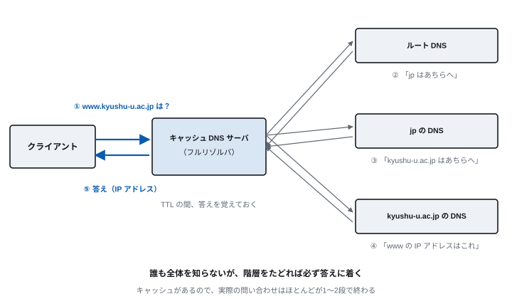
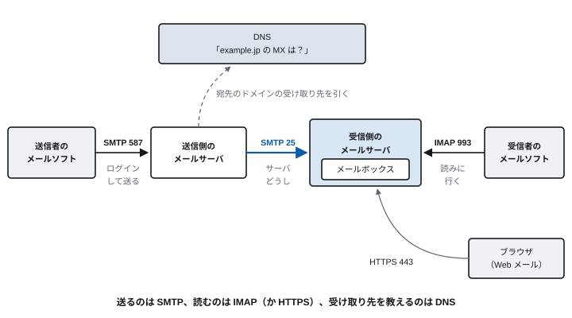

<!-- 通信工学通論　第2回 DNS と電子メール -->
<!-- slides/decks/lec02.js から node slides/tools/build-md.js で書き出したもの。
     pptx 版・HTML 版と同じ内容。直すときは decks の側を直して書き出し直す。 -->

<!-- _class: lead -->

通信工学通論

# 第2回　DNS と電子メール

*名前しか知らない相手に、どうやって届けるのか。届いたメールは本物か。*

九州大学

---

<!-- _class: lead -->

## 今回の問い

> **名前しか知らない相手に、  
どうやって届けるのか。**

そして、届いたメールが本物だと、どうして分かるのか。

この90分で、この問いに答えを出す。

---

## 到達目標

1. **DNS の名前解決** の流れを、キャッシュを含めて説明できる
2. **主なリソースレコード** （A・AAAA・MX・CNAME・TXT）の役割を説明できる
3. **電子メールが届くまで** に使われるプロトコル（SMTP・IMAP・DNS）を説明できる
4. **SPF・DKIM・DMARC** が何を確かめているかを説明できる

---

<!-- _class: lead -->

# 2.1　DNS：名前とアドレスを分ける

*誰も全体を知らないが、たどれば答えに着く*

---

<!-- 2.1　DNS -->

## なぜ DNS が要るのか

> **名前と IP アドレスを分けておけば、サーバを移しても同じ名前で届く**

- 人は 203.0.113.42 を覚えられない → **www.example.jp なら覚えられる**
- サーバを別の場所に移した → **DNS の記録を書き換えるだけ**
- 1つの名前に複数のサーバ → **負荷を分けられる**

1984年に DNS ができる前は、すべての計算機の名前と番号を1つのファイル（hosts）に書いて配っていた。  
計算機が増えると、この方法は破綻した。

---

<!-- 2.1　DNS -->

## ドメイン名の階層

ドメイン名は右から左へ階層をなす。www.kyushu-u.ac.jp の場合：

| 部分 | 例 | 担当 |
| --- | --- | --- |
| ルート | （末尾の .） | ルートサーバ（13 の系統が世界中で運用されている） |
| トップレベル | jp | 日本の国別ドメインの管理者 |
| 第2レベル | ac.jp | 大学などの教育機関に割り当てる区分 |
| 組織 | kyushu-u.ac.jp | 九州大学 |
| ホスト | www.kyushu-u.ac.jp | 九州大学の Web サーバ |

> **管理は階層的に任されている。上の階層は、すぐ下の担当者だけを知っている**

---

<!-- 2.1　DNS -->

## 名前解決の流れ



---

<!-- 2.1　DNS -->

## リソースレコード：DNS に書かれていること

| 種類 | 意味 | 例 |
| --- | --- | --- |
| A | 名前 → IPv4 アドレス | www.example.jp → 203.0.113.42 |
| AAAA | 名前 → IPv6 アドレス | www.example.jp → 2001:db8::42 |
| CNAME | 別名 | web.example.jp → www.example.jp |
| MX | メールを受け取るサーバ | example.jp → mail.example.jp（2.2 で使う） |
| NS | そのドメインを担当する DNS サーバ | example.jp → ns1.example.jp |
| TXT | 自由な文字列 | SPF や DMARC の設定（2.3 で使う） |

どのレコードにも TTL（キャッシュしてよい秒数）が付いている。TTL を短くすると変更がすぐ伝わるが、問い合わせが増える。

---

<!-- 2.1　DNS -->

## DNS の重要性と脆さ

- **止まると誰も来られない** — サーバが正常でも、名前が引けなければ誰もたどり着けない。大規模な障害の原因が DNS であることは珍しくない
- **盗み見られる** — もともと暗号化されていない。誰がどこへアクセスしようとしているかが、経路の途中で分かる
- **偽の答えを返される** — 偽の応答を覚えさせ、利用者を偽サイトへ誘導する（キャッシュポイズニング）

**DNS は1980年代の「互いを信頼できる研究者の網」を前提に作られた。今はその前提が成り立たない。**

---

<!-- 2.1　DNS の今 -->

## DNS を守る仕組み

| 仕組み | 守るもの | 内容 |
| --- | --- | --- |
| DNSSEC | 答えが本物であること | 応答に署名を付け、ルートから順に検証する |
| DoT（DNS over TLS） | 問い合わせの中身 | DNS の問い合わせを TLS で暗号化する（853番） |
| DoH（DNS over HTTPS） | 問い合わせの中身 | DNS の問い合わせを HTTPS で送る（443番） |
| 公開リゾルバ | （選択肢） | 1.1.1.1、8.8.8.8 など。誰に問い合わせを見せるかを選ぶことになる |

HTTPS レコード（2023年に標準化）を使うと、接続する前に、そのサーバが HTTP/3 を使えるかなども DNS で分かる（第3回）。

---

<!-- 2.1　実習 -->

## 実習：dig で DNS を引く（10分）

```
dig www.kyushu-u.ac.jp            # A レコード
dig www.kyushu-u.ac.jp AAAA       # IPv6
dig kyushu-u.ac.jp MX             # メールの受け取り先
dig kyushu-u.ac.jp TXT            # SPF などの設定
dig +trace www.kyushu-u.ac.jp     # ルートからたどる
dig @1.1.1.1 www.kyushu-u.ac.jp   # 問い合わせ先を指定

whois kyushu-u.ac.jp              # ドメインの登録情報
```

**やること**

① ANSWER SECTION を読み、TTL を確かめる。  
② 同じ問い合わせを2回して、2回目の Query time が短いことを確かめる。  
③ +trace で、ルート → jp → ac.jp とたどる様子を見る。  
④ MX と TXT から、大学のメールがどこで受け取られているかを推測する。

Windows では nslookup -type=MX kyushu-u.ac.jp のように使う（dig は WSL などで使える）。

---

<!-- _class: lead -->

# 2.2　電子メール

*送る SMTP、読む IMAP、宛先を教える DNS*

---

<!-- 2.2　メール -->

## メールが届くまで



---

<!-- 2.2　メール -->

## メールの中身：ヘッダと本文

### メールの例（一部）

```
Received: from mail.example.ac.jp ...
From: Alice <alice@example.ac.jp>
To: bob@example.jp
Subject: =?UTF-8?B?5omT44Gh5ZCI44KP44Gb?=
Date: Mon, 2 Nov 2026 10:00:00 +0900
MIME-Version: 1.0
Content-Type: text/plain; charset=UTF-8

来週の打ち合わせの件です。
```

### 読み方

- ヘッダと本文は、空行で分かれる
- Received: は中継したサーバが上に積む。下から読むと経路が分かる
- 日本語や添付ファイルは、MIME で文字に変換して送る
- Subject の =?UTF-8?B?…?= は「打ち合わせ」を変換したもの
- 会議の招待は、カレンダー形式（text/calendar）で添付される

---

<!-- 2.2　メール -->

## 電子メールのプロトコル

| プロトコル | ポート | 役割 |
| --- | --- | --- |
| SMTP（送信） | 587 | メールソフトから送信側のサーバへ。ログインしてから送る |
| SMTP（中継） | 25 | サーバからサーバへ |
| IMAP | 993 | サーバ上のメールボックスを読む。複数の端末で同じ状態を見られる |
| POP3 | 995 | 手元に取り込む。今はあまり使わない |
| HTTPS | 443 | Web メール（Gmail、Outlook など） |

SMTP は1982年（RFC 821）からほぼ同じ形で使われている。暗号化（TLS）やログインは、後から付け加えられた。

---

<!-- 2.2　メール -->

## SMTP の会話を見る

```
S: 220 mail.example.jp ESMTP
C: EHLO client.example.ac.jp
S: 250 mail.example.jp
C: MAIL FROM:<alice@example.ac.jp>
S: 250 OK
C: RCPT TO:<bob@example.jp>
S: 250 OK
C: DATA
S: 354 End data with <CR><LF>.<CR><LF>
C: （ヘッダと本文）……最後に「.」だけの行
S: 250 Queued
C: QUIT
```

**読み方**

S はサーバ、C はクライアント。人が読める文字のやりとりである（第1回）。

3桁の数字で結果を返す。2xx は成功、5xx は失敗。HTTP のステータスコード（第3回）と同じ考え方である。

MAIL FROM の送信者は、自己申告にすぎない（2.3 へ）。

実際には STARTTLS で暗号化してから続ける。デモ：koidelab の basic_mail.yaml でサーバとのやりとりを見せる。

---

<!-- _class: lead -->

# 2.3　届いたメールは本物か

*差出人は、自己申告にすぎない*

---

<!-- 2.3　送信元 -->

## From は、誰でも書ける

> **SMTP には、差出人が本物かを確かめる仕組みがもともとない**

- From: に書く → **好きなアドレスを書ける**
- MAIL FROM で名乗る → **自己申告にすぎない**
- だから → **受け取る側が DNS で確かめる**

迷惑メールとフィッシングの多くは、この性質を突いている。

---

<!-- 2.3　送信元 -->

## 送信元を確かめる3つの仕組み

| 仕組み | 確かめること | どこに書くか |
| --- | --- | --- |
| SPF | 送ってきたサーバの IP アドレスが、そのドメインの送信元として登録されているか | DNS の TXT |
| DKIM | メールに付いた電子署名が正しいか（途中で書き換えられていないか） | 公開鍵を DNS に載せる |
| DMARC | SPF・DKIM の結果と From のドメインが一致するか。失敗したらどう扱うか | DNS の TXT（_dmarc） |

> **2024年から Gmail などが、大量にメールを送る送信者にこれらの設定を求めている**

---

<!-- 2.3　送信元 -->

## DNS の設定と、受け取った側の判定

### 送る側：DNS に書く（例）

```
example.jp.  TXT
  "v=spf1 ip4:203.0.113.0/24 -all"

sel._domainkey.example.jp.  TXT
  "v=DKIM1; k=rsa; p=MIIBIjAN…"

_dmarc.example.jp.  TXT
  "v=DMARC1; p=reject"
```

### 受け取る側：ヘッダに残る判定

```
Authentication-Results:
  mx.example.ac.jp;
  spf=pass smtp.mailfrom=example.jp;
  dkim=pass header.d=example.jp;
  dmarc=pass header.from=example.jp
```

**Gmail なら「メッセージのソースを表示」で、届いたメールのこの行を見られる。実際に確かめてみよう。**

---

<!-- 2.3　フィッシング -->

## AI で巧妙になったフィッシング

- **日本語の不自然さでは見抜けない** — 生成AI で、自然な日本語の文面を大量に作れるようになった
- **なりすましの声と映像** — ビデオ会議で幹部になりすました指示により、多額を送金させた事例がある（2024年・香港）
- **手がかりは技術の側にある** — SPF・DKIM・DMARC の結果、リンク先のドメイン、パスキー（第8回）

**「文面がおかしいから怪しい」は、もう通用しない。**

---

<!-- 2.3　第7回への問い -->

## 1日150通のメールから、会議の招待だけを拾えるか

講師に届くメールは平日1日に約150通。7割以上が自動送信のお知らせや広告で、その中に会議の招待が数通だけ混ざっている。

> **これを AI に任せるには、何を読ませ、何をさせればよいか**

- 宛先がばらばら → **6つのアドレス宛てが1つの受信箱に集まる**
- 形式がばらばら → **添付のものも、URL だけのものも**
- 人が毎日拾うのは → **無理がある**

答えは第7回で。そのとき、今日学んだ MIME・カレンダー形式・SMTP がそのまま出てくる。

---

## 演習

- **2-1**　キャッシュが空のとき、www.kyushu-u.ac.jp の名前解決がどの順で進むかを説明せよ。
- **2-2**　（手を動かす）dig で kyushu-u.ac.jp の MX と TXT を引き、大学のメールがどこで受け取られているかを推測せよ。
- **2-3**　メールを送るときと読むときに使うプロトコルとポート番号を、それぞれ答えよ。
- **2-4**　SMTP で差出人を偽れるのはなぜか。SPF・DKIM・DMARC がそれぞれ何を確かめているかとともに説明せよ。

---

## まとめ

| 項目 | 要点 |
| --- | --- |
| DNS | 名前と IP アドレスを分ける。階層をたどれば、誰も全体を知らなくても答えに着く |
| キャッシュ | TTL の間は覚えておく。だから実際の問い合わせはほとんどが1〜2段で終わる |
| DNS の守り | DNSSEC で改ざんを見抜き、DoT・DoH で盗み見を防ぐ |
| 電子メール | 送るのは SMTP、読むのは IMAP、受け取り先を教えるのは DNS の MX |
| 送信元の認証 | 差出人は自己申告。SPF・DKIM・DMARC で、受け取る側が DNS を使って確かめる |

次回　第3回　WWW と HTTP
