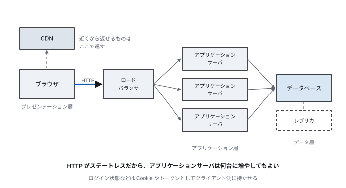
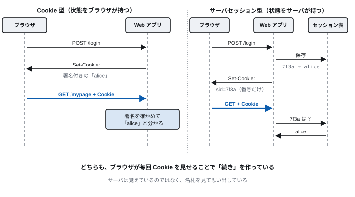
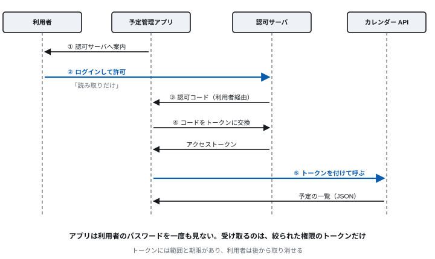

<!-- 通信工学通論　第4回 Web アプリケーションと Web API -->
<!-- slides/decks/lec04.js から node slides/tools/build-md.js で書き出したもの。
     pptx 版・HTML 版と同じ内容。直すときは decks の側を直して書き出し直す。 -->

<!-- _class: lead -->

通信工学通論

# 第4回　Web アプリケーションと Web API

*状態を持たない HTTP の上で、ログインや掲示板はどう作られているのか。*

九州大学

---

<!-- _class: lead -->

## 今回の問い

> **状態を持たない HTTP の上で、  
ログインはどう作られているのか。**

そして、プログラムどうしは Web をどう使ってやりとりしているのか。

この90分で、この問いに答えを出す。

---

## 到達目標

1. **Web アプリの三層構成** を説明できる
2. **Cookie とセッション** でログイン状態を保つ2つの方式を説明できる
3. **REST と JSON** で作られた Web API を読み、呼び出せる
4. **WebSocket と SSE** が何のためにあるかを説明できる
5. **OAuth 2.0 と OpenID Connect** が何を任せているかを説明できる

---

<!-- _class: lead -->

# 4.1　Web アプリケーション

*ページを見せるだけでなく、仕事をする*

---

<!-- 4.1　Web アプリ -->

## Web 2.0 から、今の Web アプリへ

### Web 2.0（2005年頃）

- 利用者が書き込み、共有する（ブログ、SNS、Wiki）
- ページ全体を読み直さずに一部を更新する（Ajax）
- Web がアプリケーションの土台になる

### 今の Web アプリ

- 1枚のページの中で、JavaScript が画面を作り替える（SPA）
- データは Web API から JSON で受け取る
- スマートフォンのアプリも同じ API を使う

**Google マップ（2005年）は、ページを読み直さずに地図を動かせることで驚かれた。今はそれが当たり前になった。**

---

<!-- 4.1　Web アプリ -->

## Web アプリケーションの三層構成



各層を独立に増やせる。アクセスが増えたらアプリサーバを、データが増えたら DB を強くする。

---

<!-- _class: lead -->

# 4.2　ログイン状態を保つ

*Cookie が、ステートレスな HTTP に記憶を足す*

---

<!-- 4.2　Cookie -->

## Cookie とは

- **サーバが渡す** — 応答の Set-Cookie ヘッダで、ブラウザに小さなデータを保存させる
- **ブラウザが返す** — 同じサイトへのその後の要求に、Cookie ヘッダで自動的に付けて送る
- **使いみち** — ログイン状態、カートの中身、表示の設定

> **HTTP はステートレス。状態は Cookie として、要求に毎回乗せる**  
> サーバは「覚えている」のではなく、毎回「名札を見せてもらって」いる。

---

<!-- 4.2　セッション -->

## ログイン状態を保つ2つの方式



---

<!-- 4.2　セッション -->

## 2つの方式の比較

|  | Cookie 型 | サーバセッション型 |
| --- | --- | --- |
| 状態を持つ場所 | ブラウザ（署名して書き換えを防ぐ） | サーバの表（ブラウザには番号だけ） |
| サーバを増やすとき | そのまま増やせる | セッションの表を共有する必要がある |
| 強制的にログアウトさせる | 難しい（期限まで有効） | 表から消せばよい |
| Cookie が盗まれたら | 期限まで使われうる | 表から消せば止められる |

どちらの方式でも、Cookie が盗まれれば、なりすましが起きる（第8回のセッションハイジャック）。  
vuln-webapp の教材アプリでは、2つの方式を切り替えて比べられる。

---

<!-- _class: lead -->

# 4.3　Web API

*プログラムどうしが HTTP で話す*

---

<!-- 4.3　Web API -->

## Web API：相手は人ではなくプログラム

> **同じ HTTP で、HTML の代わりに JSON を返す**

- ブラウザで人が見る → **HTML を返す**
- プログラムが使う → **JSON を返す**
- スマホのアプリ・IoT 機器・AI → **同じ API を呼ぶ**

天気、地図、決済、翻訳、LLM —— 多くのサービスが Web API を公開している。

---

<!-- 4.3　REST -->

## REST：資源を URL で、操作をメソッドで

| 操作 | メソッドと URL | 意味 |
| --- | --- | --- |
| 一覧 | GET /posts | 投稿の一覧を取る |
| 1件 | GET /posts/42 | 42 番の投稿を取る |
| 作成 | POST /posts | 新しい投稿を作る |
| 更新 | PUT /posts/42 | 42 番を置き換える |
| 削除 | DELETE /posts/42 | 42 番を消す |

> **URL が名詞、メソッドが動詞になる**

REST は、2000年に Roy Fielding が博士論文で示した設計の考え方である。

---

<!-- 4.3　JSON -->

## JSON：データの書き方

### 例：掲示板の投稿1件

```
{
  "id": 42,
  "author": "alice",
  "text": "明日のゼミは14時から",
  "tags": ["ゼミ", "連絡"],
  "likes": 3,
  "pinned": false
}
```

### 読み方

- { } はオブジェクト（名前と値の組）、[ ] は配列
- 文字列・数・真偽値・null を表せる
- ほとんどのプログラミング言語で読み書きできる
- Content-Type: application/json で送る
- 第6・7回の LLM API や MCP も、この形でやりとりする

---

<!-- 4.3　押し出す通信 -->

## サーバから送りたいとき：SSE と WebSocket

HTTP は「要求があって初めて応答する」形なので、サーバから先に送りたいときに工夫が要る。

| 方式 | 向き | 向いている用途 |
| --- | --- | --- |
| ポーリング | クライアントが繰り返し聞く | 単純だが、無駄な要求が多い |
| SSE（Server-Sent Events） | サーバ → クライアント（片方向） | 通知、LLM の答えを少しずつ表示する（第6回） |
| WebSocket | 双方向 | チャット、共同編集、オンラインゲーム |

---

<!-- 4.3　確かめる -->

## 確かめてみよう：公開されている API を呼ぶ

```
curl -i https://api.github.com/users/octocat

HTTP/2 200
content-type: application/json; charset=utf-8
x-ratelimit-remaining: 59

{
  "login": "octocat",
  "public_repos": …,
  …
}
```

**読み方**

GitHub の API は、認証なしでも一部を呼べる（回数に制限がある）。

応答ヘッダの x-ratelimit-remaining で、残りの回数が分かる。使い切ると 403 や 429 が返る。

ブラウザで同じ URL を開くと、JSON がそのまま見える。

---

<!-- _class: lead -->

# 4.4　OAuth 2.0 と OpenID Connect

*パスワードを渡さずに、権限だけを渡す*

---

<!-- 4.4　OAuth -->

## OAuth 2.0：権限をトークンで渡す



---

<!-- 4.4　OAuth -->

## OAuth 2.0 と OpenID Connect

|  | OAuth 2.0 | OpenID Connect |
| --- | --- | --- |
| 目的 | 認可：このアプリに何をさせてよいか | 認証：この人は誰か |
| 受け取るもの | アクセストークン | ID トークン（誰がログインしたか） |
| 例 | 「カレンダーの読み取りだけを許可する」 | 「Google でログイン」 |

> **パスワードを渡さないので、権限を絞れ、期限を付けられ、後から取り消せる**

第7回の AIエージェントも、メールやカレンダーを使う許可を OAuth で受け取っている。

---

<!-- _class: lead -->

# 4.5　実習：Web API を作って呼ぶ

*第3回の bottle を広げる*

---

<!-- 4.5　実習 -->

## 実習：JSON を返す API を作る（api.py）

```
from bottle import get, post, request, run

posts = []

@get('/api/posts')
def list_posts():
    return {'posts': posts}          # 辞書を返すと JSON になる

@post('/api/posts')
def add_post():
    data = request.json              # 送られてきた JSON を読む
    posts.append({'id': len(posts) + 1, 'text': data['text']})
    return {'ok': True, 'count': len(posts)}

run(host='localhost', port=8080)
```

GET で一覧を返し、POST で1件を受け取る。bottle は、関数が辞書を返すと JSON にして Content-Type も付けてくれる。

---

<!-- 4.5　実習 -->

## 呼んでみる

```
curl -X POST localhost:8080/api/posts \
     -H 'Content-Type: application/json' \
     -d '{"text": "こんにちは"}'

curl localhost:8080/api/posts
# → {"posts": [{"id": 1, "text": "こんにちは"}]}
```

**やること**

① 2件投稿してから、一覧を取る。  
② サーバを止めて起動し直すと、投稿は消える。なぜか（三層構成の DB の層がない）。  
③ 存在しない URL を呼ぶと、何が返るか。  
④ 発展：iot-handson の受信サーバに、温度を JSON で POST する。

Windows の PowerShell では引用符の扱いが違う。curl.exe を使い、JSON はファイルに書いて -d @post.json で送るとよい。

---

## 演習

- **4-1**　HTTP はステートレスなのに、ログイン状態が続くのはなぜか。Cookie の働きから説明せよ。
- **4-2**　Cookie 型とサーバセッション型の違いを、強制的にログアウトさせるときの観点から説明せよ。
- **4-3**　（手を動かす）実習の API に、投稿を1件消す DELETE /api/posts/&lt;id> を追加せよ。
- **4-4**　OAuth を使うと、外部のアプリにパスワードを教えずに済むのはなぜか。アクセストークンの性質とともに説明せよ。

---

## まとめ

| 項目 | 要点 |
| --- | --- |
| Web アプリ | ブラウザ・アプリサーバ・DB の三層。HTTP がステートレスだからサーバを増やせる |
| Cookie | ステートレスな HTTP に記憶を足す。状態をブラウザに持つか、サーバに持つか |
| Web API | HTML の代わりに JSON を返す。REST では URL が名詞、メソッドが動詞 |
| 押し出す通信 | SSE は片方向、WebSocket は双方向。LLM の答えが少しずつ出るのは SSE |
| OAuth | パスワードを渡さず、絞った権限をトークンで渡す。OpenID Connect は「誰か」を伝える |

次回　第5回　クラウド・仮想化・P2P
