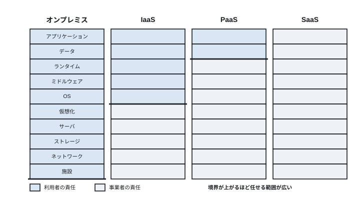
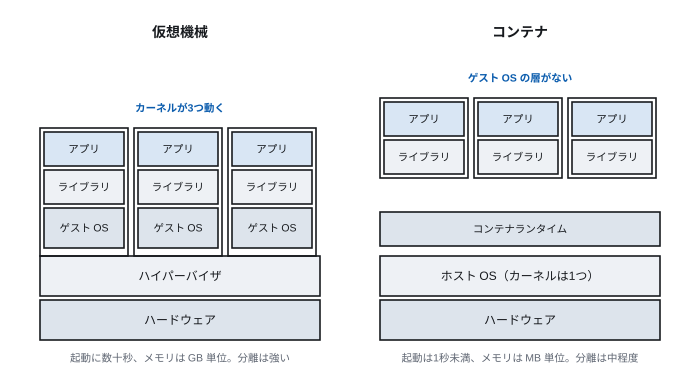
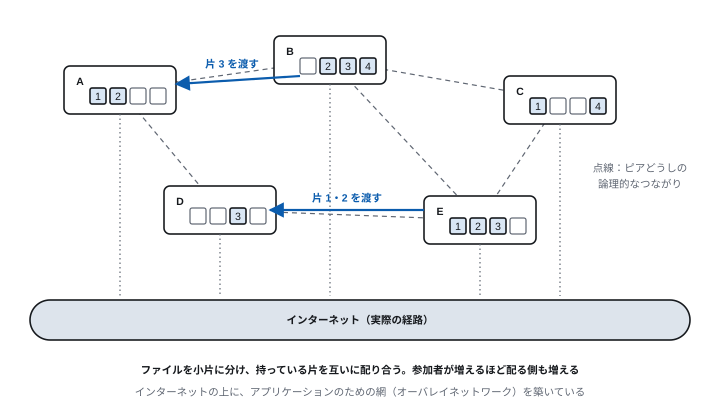
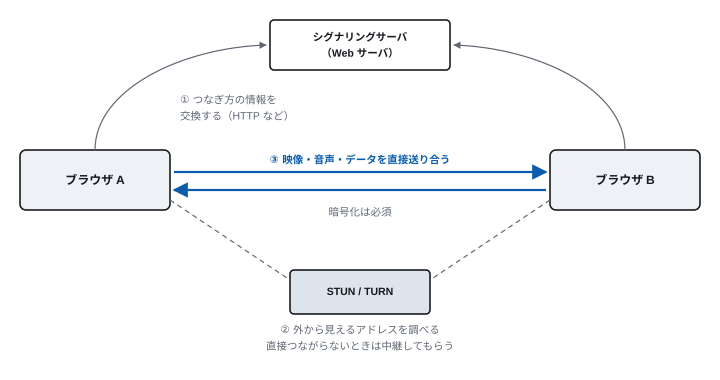

<!-- 通信工学通論　第5回 クラウド・仮想化・P2P -->
<!-- slides/decks/lec05.js から node slides/tools/build-md.js で書き出したもの。
     pptx 版・HTML 版と同じ内容。直すときは decks の側を直して書き出し直す。 -->

<!-- _class: lead -->

通信工学通論

# 第5回　クラウド・仮想化・P2P

*アプリはどこで動いているのか。サーバを置かずに動かす形はありうるのか。*

九州大学

---

<!-- _class: lead -->

## 今回の問い

> **アプリは、  
どこで動いているのか。**

そして、サーバを置かずに動かす形はありうるのか。

この90分で、この問いに答えを出す。

---

## 到達目標

1. **クラウド** で何が変わったかを、責任の分け方とともに説明できる
2. **仮想機械とコンテナ** の違いを説明できる
3. **Docker** で Web サーバと DB を動かせる
4. **P2P** の仕組みと、利点・弱点を説明できる
5. **AI を支えるインフラ** の特徴（GPU、学習と推論、電力）を説明できる

---

<!-- _class: lead -->

# 5.1　クラウドコンピューティング

*本質は、失敗のコストが下がったこと*

---

<!-- 5.1　クラウド -->

## 何が変わったのか

|  | 自前で持つ（オンプレミス） | クラウド |
| --- | --- | --- |
| 調達 | 見積り・発注・搬入・設置に数週間〜数か月 | 数分 |
| 費用の性質 | 設備投資（先に大きく払う） | 経費（使った分だけ） |
| 容量の決め方 | ピークに合わせて買う | 需要に応じて増減させる |
| 失敗のコスト | 買った機材が無駄になる | 消せば止まる |

> **もっとも大きな変化は、失敗のコストが下がったこと**

履修登録のシステムは、年に数日だけ負荷が跳ね上がり、残りの日は空いている。  
「試してみて、駄目ならやめる」が数千円でできるようになった。

---

<!-- 5.1　クラウド -->

## サービスの形

| 形 | 借りるもの | 例 |
| --- | --- | --- |
| IaaS | 仮想機械・ネットワーク・ストレージ。OS から上は自分で用意する | Amazon EC2、Google Compute Engine |
| PaaS | アプリを動かす環境まで。アプリとデータだけを用意する | Google App Engine など |
| SaaS | アプリそのもの | Gmail、Microsoft 365、Zoom |
| サーバレス | 関数を置くだけ。呼ばれたときだけ動き、動いた分だけ払う | AWS Lambda など |

下の行ほど、事業者に任せる範囲が広い。次の図で、誰が何に責任を持つかを見る。

---

<!-- 5.1　クラウド -->

## サービスの形と責任の分け方



事業者は施設・機材・ハイパーバイザを、利用者はアクセス権限・データ・アカウントの管理を受け持つ。  
実際の情報漏えいの多くは、事業者ではなく利用者側の設定の誤りによる。

---

<!-- 5.1　クラウド -->

## クラウドの暗黒面

- **ベンダロックイン** — 特定の事業者のサービスに頼り切ると、移るのが事実上できなくなる
- **障害の巻き添え** — 事業者の障害で、無関係な多くのサービスが同時に止まる
- **費用の逆転** — 使う量が安定して多いと、自前のほうが安い。設定の誤りや攻撃で請求が跳ね上がる
- **データの所在** — 国をまたいだ保管が、各国の法律に触れうる
- **見えにくさ** — 中で何が起きているか分からず、問題の切り分けが難しい
- **サービスの終了** — 事業者の都合で機能が廃止される

**大きな事業者ほど、障害の影響範囲が広い。効率のための集中が、社会全体の弱点にもなっている。**

---

<!-- _class: lead -->

# 5.2　仮想化とコンテナ

*「計算機そのもの」を抽象化する*

---

<!-- 5.2　仮想化 -->

## 仮想化で得られるもの

1台の物理計算機の上に、複数の「仮想的な計算機」を作る。それを実現するソフトウェアがハイパーバイザである。

- **集約** — 1台の物理サーバに多くの仮想機械を載せ、資源を無駄なく使う
- **分離** — ある仮想機械の障害や侵害が、ほかに及びにくい
- **持ち運べる** — 動いたまま、別の物理サーバへ移せる（ライブマイグレーション）
- **網も仮想化する** — 物理の網の上に、独立した仮想の網を作る（SDN）

> **これが、そのままクラウドの技術的な土台になる**  
> ハイパーバイザの例：VMware、Hyper-V、KVM、Xen

---

<!-- 5.2　仮想化 -->

## 仮想機械とコンテナ

仮想機械には無駄がある。OS を丸ごと複製していることである。



コンテナはカーネルを1つ共有したまま、プロセスから見える世界だけを分ける。

---

<!-- 5.2　仮想化 -->

## どちらを選ぶか

|  | 仮想機械 | コンテナ |
| --- | --- | --- |
| 分けるもの | ハードウェア | プロセスから見える世界と資源 |
| カーネル | 仮想機械ごとに1つ | ホストのものを共有 |
| 起動時間 | 数十秒 | 1秒未満 |
| メモリ | GB 単位 | MB 単位 |
| 分離の強さ | 強い | 中程度（カーネルの弱点は共有される） |
| 違う OS | 動かせる | 動かせない |

強い分離が要るとき（別の顧客の処理、信頼できないコード）は仮想機械、自分たちのアプリを効率よく  
たくさん動かすときはコンテナ。クラウドでは「仮想機械の中でコンテナ」が一般的である。

**コンテナが数千になると人手では管理できない。これを自動化するのが Kubernetes である。**

---

<!-- 5.2　セキュリティ -->

## 仮想化とセキュリティ

- **土台を信頼できるか** — ハイパーバイザやホスト OS が乗っ取られると、上のすべてが危ない。起動時に正しさを確かめる仕組み（セキュアブート、TPM）
- **コンテナの分離は中程度** — カーネルを共有するので、カーネルの弱点を突かれると分離が破られうる
- **イメージの出どころ** — 公開イメージには、古い部品や悪意あるものが混ざることがある。信頼できるものを使い、更新し続ける
- **設定の誤り** — 管理画面やストレージを、誤って誰でも見られる状態にする事故が多い

---

<!-- _class: lead -->

# 5.3　実習：Docker で動かす

*コマンド1つで、Web サーバも DB も立つ*

---

<!-- 5.3　実習1 -->

## 実習1：Web サーバを立てる

```
docker run --name nginx01 --detach \
           --publish 18888:80 nginx
docker ps
curl -s http://localhost:18888/ | head
docker logs nginx01

# 片付け
docker stop nginx01
docker rm nginx01
```

**読み方**

--publish 18888:80 は、手元の 18888 番をコンテナの 80 番につなぐ（第1回のポート番号）。

docker logs で、届いた HTTP の要求が1行ずつ見える（第3回）。

止めて消せば、跡形もなくなる。

教材：docker-lesson の演習01。Docker Desktop のインストールは setup/README.md を参照。

---

<!-- 5.3　実習2 -->

## 実習2：DB を立てて、中に入る

```
docker run --name mydb -d \
  --env MYSQL_ROOT_PASSWORD=hello001 \
  -p 3306:3306 mysql:8.0

docker exec -it mydb mysql -uroot -phello001

mysql> CREATE DATABASE demo;
mysql> USE demo;
mysql> CREATE TABLE posts (id INT, text TEXT);
```

**やること**

① 起動には10〜20秒かかる。docker logs で ready for connections を待つ。  
② テーブルを作り、データを入れて読む。  
③ 第4回の API に足りなかった「DB の層」が、これで手に入る。

パスワードは演習用。実際の運用では使わない。

教材：docker-lesson の演習03。

---

<!-- 5.3　実習3 -->

## 実習3：自分のイメージを作る

```
# Dockerfile
FROM alpine:3.20
CMD ["sh", "-c", "echo 'Hello from my first image!' && date"]

docker build -t myhello:1.0 .
docker run --rm myhello:1.0
docker images | grep myhello
```

イメージはコンテナの「型」で、作り方を Dockerfile に書く。同じイメージからは、どの計算機でも同じ環境が立つ。  
第4回の api.py を入れたイメージを作れば、そのままクラウドに持って行ける。教材：docker-lesson の演習04。

---

<!-- _class: lead -->

# 5.4　P2P：サーバを置かない形

*参加者どうしが、互いに配り合う*

---

<!-- 5.4　P2P -->

## クライアント・サーバと P2P

|  | クライアント・サーバ | P2P |
| --- | --- | --- |
| 提供する側 | サーバ（決まっている） | 参加者全員（ピア） |
| 規模が急に大きくなったら | サーバを増やす必要がある | 配る側も増えるので耐えられる |
| 障害 | サーバが止まると全体が止まる | 一部が抜けても続く |
| 管理・監視 | しやすい | 難しい |
| データの一元的な管理 | 得意 | 苦手 |

---

<!-- 5.4　P2P -->

## オーバレイネットワークとファイルの交換



---

<!-- 5.4　P2P -->

## ピアを見つけ、ファイルを探す

- **ピアを見つける** — 最初に知っているピア（シード）から、数珠つなぎに他のピアを教えてもらう
- **探す** — 検索の依頼をピアからピアへ回す。何段か回したら打ち切り、同じ依頼は捨てる
- **分散ハッシュ表** — 誰が何を持っているかを、決まった規則で分担して覚える。BitTorrent などが使う

**検索の依頼で網がいっぱいにならないように、回し方のルールが要る。**

---

<!-- 5.4　P2P -->

## P2P が使われているところ

| 用途 | 例 | ひとこと |
| --- | --- | --- |
| ファイルの配布 | BitTorrent | 大きなファイル（OS のイメージなど）を多くの人に配る |
| ビデオ通話・画面共有 | WebRTC | ブラウザどうしが直接つながる（次の図） |
| 暗号資産 | ビットコイン | 中央の機関なしに、取引の記録を皆で持つ（ブロックチェーン） |

P2P という技術そのものは中立である。かつては著作権を侵害するファイル共有ソフト（Winny など）が社会問題になった。  
大学のネットワークでファイル共有ソフトを使う前には、規程を確認すること。

---

<!-- 5.4　WebRTC -->

## WebRTC：ブラウザどうしが直接つながる

最初のつなぎ方の相談だけはサーバを使い、映像や音声はブラウザどうしが直接送り合う。サーバの負荷と遅延が減る。



---

<!-- _class: lead -->

# 5.5　AI を支えるインフラ

*巨大なモデルは、データセンターで動く*

---

<!-- 5.5　AI のインフラ -->

## 学習と推論

|  | 学習 | 推論 |
| --- | --- | --- |
| 何をするか | 大量のデータで、モデルのパラメータを決める | できたモデルで、答えを作る |
| いつ | 開発するときに一度（数週間〜数か月） | 利用者が使うたびに毎回 |
| 計算機 | 数千〜数万の GPU を、速い網でつなぐ | GPU を並べたサーバ。利用者が多いほど多く要る |
| ネットワークの役割 | GPU どうしが途中の結果を大量に交換する | 利用者からの要求を API で受ける（第6回） |

> **クラウドの「使った分だけ払う」は AI でも同じ。LLM API はトークンの数で料金が決まる**

---

<!-- 5.5　AI のインフラ -->

## AI のデータセンターが抱える問題

- **電力** — 大規模な AI のデータセンターには、都市1つ分に近い電力を使う計画もある
- **冷却** — GPU の発熱を逃がすため、空気で冷やす方式から水で冷やす方式へ移りつつある
- **立地** — 電力と冷却水が得られる場所に建てる。地域の資源の問題にもなる

**第6回では、このデータセンターで動く LLM を、ネットワーク越しにどう使うかを見る。**

---

## 演習

- **5-1**　クラウドで「失敗のコストが下がった」とはどういうことか。オンプレミスと比べて説明せよ。
- **5-2**　仮想機械とコンテナの違いを、カーネルと分離の強さの観点から説明せよ。
- **5-3**　（手を動かす）docker run で nginx を起動し、docker logs に出た1行を読んで、何が記録されているかを説明せよ。
- **5-4**　P2P が「規模の急拡大に強い」理由と、「データの一元的な管理が苦手」な理由をそれぞれ説明せよ。

---

## まとめ

| 項目 | 要点 |
| --- | --- |
| クラウド | 必要なときに借り、要らなくなれば返す。失敗のコストが下がった。責任は事業者と分け合う |
| 仮想化 | 計算機そのものを抽象化する。仮想機械は OS ごと、コンテナはプロセスの見え方だけを分ける |
| Docker | イメージから、同じ環境をどこでも立てられる。ポートの対応で外とつなぐ |
| P2P | 参加者どうしが配り合う。規模と障害に強いが、管理と一元化は苦手 |
| AI のインフラ | 学習は GPU を大量につなぎ、推論は API で毎回動く。電力と冷却が課題 |

次回　第6回　LLM のしくみと API
