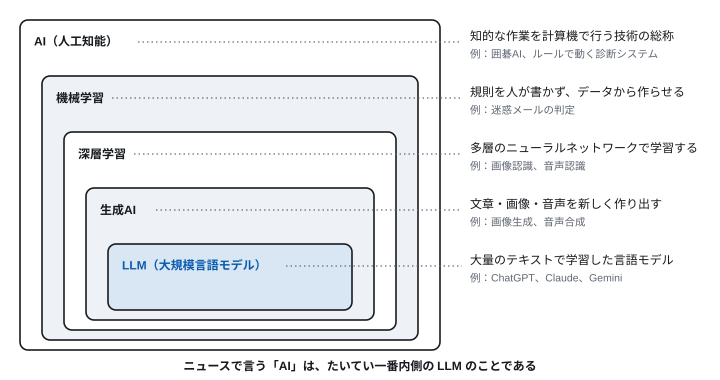
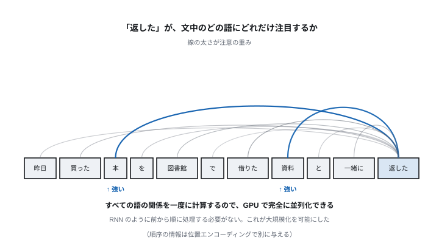
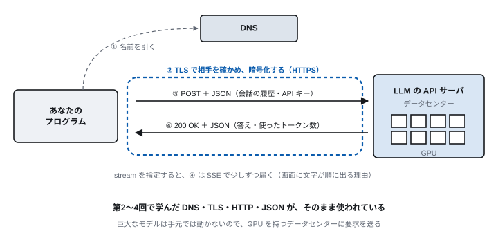

<!-- 通信工学通論　第6回 LLM のしくみと API -->
<!-- slides/decks/lec06.js から node slides/tools/build-md.js で書き出したもの。
     pptx 版・HTML 版と同じ内容。直すときは decks の側を直して書き出し直す。 -->

<!-- _class: lead -->

通信工学通論

# 第6回　LLM のしくみと API

*LLM は何をしていて、ネットワークの上でどう使われているのか。*

九州大学

---

<!-- _class: lead -->

## 今回の問い

> **LLM は何をしていて、  
ネットワークの上でどう使われているのか。**

中身は「次のトークンの予測」と「HTTPS の POST」である。

この90分で、この問いに答えを出す。

---

## 到達目標

1. **AI・機械学習・深層学習・生成AI・LLM** の関係を説明できる
2. **LLM が次のトークンを確率的に選ぶこと** と、そこから来る弱点を説明できる
3. **LLM API の要求と応答** を、HTTP と JSON の言葉で説明できる
4. **構造化出力** を使って、LLM の答えをプログラムで扱える
5. **生成AI を使うときのリスク** （情報漏えい・誤情報）と、確かめ方を説明できる

---

<!-- _class: lead -->

# 6.1　言葉を整理する

*「AI」が指す範囲は広すぎる*

---

<!-- 6.1　用語 -->

## AI という言葉の入れ子



---

<!-- 6.1　用語 -->

## AI の種類

| 種類 | 何をするか | 例 |
| --- | --- | --- |
| 特定用途の AI | 決まった1つの仕事をこなす | 画像認識、自動運転、囲碁 |
| 生成AI | 文章・コード・画像を生成して答える | ChatGPT、Copilot |
| マルチモーダル AI | 文字・画像・音声をまとめて扱う | 写真を見て説明する、声で会話する |
| AIエージェント | 目的を与えると、道具を使って自分で動く | 調べて、まとめて、予定を登録する |
| 汎用人工知能（AGI） | どんな知的作業も人間並みにこなす | まだ実現していない。定義にも議論がある |

> **この回は LLM と生成AI を、次の第7回は AIエージェントを扱う**

---

<!-- 6.1　用語 -->

## 「答える」AI から「動く」AI へ

### 生成AI（答える）　← 第6回

- 文書作成・要約・翻訳
- 調査・アイデア出し
- コード生成

*→ 人が読んで使う*

### AIエージェント（動く）　← 第7回

- メール・カレンダー・ファイルに接続する
- 情報を集め、判断の候補を出し、実行する
- チケットの起票、コードの修正

*→ AI が仕事を進める*

**どちらも土台は LLM である。まずは LLM そのものと、それをネットワーク越しに使う仕組みを見る。**

---

<!-- _class: lead -->

# 6.2　LLM のしくみ

*確率的に、次のトークンを選んでいる*

---

<!-- 6.2　LLM -->

## なぜ今になって実用化したのか

1. **2012年** — 深層学習が画像認識で従来の手法を大きく上回る。GPU が決め手だった
2. **2017年** — Transformer の発表。文全体を並列に処理できるようになった
3. **2020年前後** — モデルとデータを大きくするほど性能が上がることが分かる
4. **2022年** — ChatGPT の公開。誰もが対話で使えるようになった
5. **2024年〜** — 道具を使って自分で動くエージェントが実用に入る

GPU を並べたデータセンター（第5回）、インターネット上の大量のテキスト、Transformer。  
この3つが揃って、大規模化が可能になった。

---

<!-- 6.2　LLM -->

## 自己注意：文中のすべての語の関係を一度に計算する

「返した」を理解するには、離れた位置の「本」や「資料」を見る必要がある。Transformer は、各語が文中の全ての語との関連の強さを計算し、関連の強い語の情報を取り込む。



---

<!-- 6.2　LLM -->

## LLM の学習過程

LLM は Transformer を土台に、巨大なテキストで学習した言語モデルである。

| 段階 | 内容 | 使うデータ |
| --- | --- | --- |
| 1. 事前学習 | 「次のトークンを当てる」を延々と繰り返す | 大量のテキスト（正解ラベルは要らない） |
| 2. 指示への適応 | 指示に従って答える形式を学ぶ | 人間が作った指示と応答の例 |
| 3. 好みに合わせた調整 | 人間が好む応答を選ぶよう調整する | 人間による応答の比較評価 |

> **「次のトークンを当てる」を突き詰めると、文法・事実・文脈の構造を身につけざるを得ない**

トークンは文字でも単語でもない単位。日本語は1文字が1〜2トークンになりやすく、同じ内容でも英語よりトークン数が多い。

---

<!-- 6.2　LLM -->

## LLM は確率的に次のトークンを選んでいる

それ以上でも以下でもない。ここから次の性質が出てくる。

- **ハルシネーション** — 事実を調べて答えるのではなく、もっともらしい続きを生成する。もっともらしさと正しさは別物である
- **同じ質問でも答えが変わる** — 次のトークンを確率で選ぶので、毎回少しずつ違う答えになる。実習で確かめる
- **学習時点より後を知らない** — 事前学習のデータには締め切りがある
- **学習データの偏り** — データに含まれる偏見や不均衡が、そのまま出力に現れる

> **バグではなく、仕組みからの帰結である**  
> 「知らない」ことを検知する仕組みが、もともと組み込まれていない。

---

<!-- 6.2　LLM -->

## 弱点を補う仕組み

| 手法 | 何を解決するか |
| --- | --- |
| RAG（検索拡張生成） | 関連する文書を検索して入力に加え、それに基づいて答えさせる。最新の情報と根拠を示せる |
| ツール利用 | 計算・検索・コード実行・Web API の呼び出しを、外の道具に任せる（第7回） |
| 構造化出力 | 答えの形を JSON Schema で決めておき、プログラムが確実に読めるようにする（この回の実習） |
| ファインチューニング | 特定の分野や書き方に合わせて追加で学習する |

> **ツール利用と構造化出力が、第7回のエージェントの土台になる**

---

<!-- _class: lead -->

# 6.3　LLM をネットワーク越しに使う

*中身は HTTPS の POST と JSON*

---

<!-- 6.3　LLM API -->

## LLM API を呼ぶとき、ネットワークで起きていること



---

<!-- 6.3　LLM API -->

## 要求と応答を見る

第3回で使った curl で、そのまま送れる。

### 要求（curl で送る）

```
curl https://api.openai.com/v1/chat/completions \
  -H "Authorization: Bearer $OPENAI_API_KEY" \
  -H "Content-Type: application/json" \
  -d '{
    "model": "<モデル名>",
    "messages": [
      {"role": "system",
       "content": "1年生に分かるように"},
      {"role": "user",
       "content": "インシデント対応とは？"}
    ]}'
```

### 応答（JSON。一部を省略）

```
HTTP/2 200
content-type: application/json

{
  "choices": [{
    "message": {
      "role": "assistant",
      "content": "サイバー攻撃を受けた…"
    }
  }],
  "usage": {"prompt_tokens": 41,
            "completion_tokens": 96}
}
```

**メソッドは POST、認証は Authorization ヘッダ、本文は JSON。第3回の HTTP そのものである。**

---

<!-- 6.3　LLM API -->

## 第2〜4回の知識との対応

| これまでに学んだこと | LLM API では |
| --- | --- |
| POST メソッド | 会話を送って、続きを生成してもらう |
| Authorization ヘッダ | API キーを送る。漏れると他人に使われ、こちらに課金される |
| Content-Type: application/json | 要求も応答も JSON |
| ステータスコード | 401 はキーの誤り、429 は呼びすぎか残高不足 |
| SSE（第4回） | stream を指定すると、答えが少しずつ届く |
| DNS と TLS（第2・3回） | API サーバの名前を引き、証明書で相手を確かめる |

実習で使う llm.py は、401・404・429 を受け取ると、何をすればよいかを日本語で表示する。

---

<!-- 6.3　LLM API -->

## SSE：答えが少しずつ表示される理由

要求に "stream": true を加えると、応答は次の形で少しずつ届く。

```
data: {"choices":[{"delta":{"content":"サイバー"}}]}

data: {"choices":[{"delta":{"content":"攻撃を"}}]}

data: {"choices":[{"delta":{"content":"受けた"}}]}

…

data: [DONE]
```

**Server-Sent Events（第4回）**

サーバからクライアントへ、1本の HTTP 応答の中で小さなデータを次々に送る。

全文ができあがるのを待たずに表示できるので、待ち時間が短く感じられる。

「data: [DONE]」で終わる。

---

<!-- 6.3　LLM API -->

## LLM API もステートレスである

HTTP と同じく、基本の API は前の会話を覚えていない。チャット画面で会話が続くのは、アプリが履歴を毎回送り直しているからである。

> **会話の状態を持っているのは、サーバではなくクライアント（アプリ）の側**

- 2回目の質問 → **1回目の質問と答えも一緒に送る**
- 会話が長くなる → **送るトークンが増え、料金も増える**
- 一度に送れる量の上限 → **コンテキストウィンドウ**

状態を持たない HTTP の上で「続き」を作るには工夫が要る（第4回の Cookie とセッション）。  
ここでは、履歴を丸ごと送り直すという単純な方法をとっている。サーバ側で履歴を預かる API もある。

---

<!-- 6.3　LLM API -->

## トークンと料金

- **料金の決まり方** — 入力と出力のトークン数で決まる。出力のほうが単価が高いことが多い
- **コンテキストウィンドウ** — 一度に扱えるトークン数の上限。長い会話や大きな文書は入りきらない
- **レート制限** — 一定の時間に呼べる回数や量の上限。超えると 429 が返る

**料金表は提供者ごとに違い、よく変わる。使う前に必ず確かめる。**

---

<!-- _class: lead -->

# 6.4　実習：LLM API を使う

*プログラムから呼び、答えの形を決める*

---

<!-- 6.4　実習 -->

## 準備と最初の呼び出し

```
# 教材：theme12-seminar
cd theme12-seminar/code
export OPENAI_API_KEY="（配布されたキー）"
export OPENAI_MODEL="（指定されたモデル名）"

python s1_hello.py

# 記録を見る（入力・出力・トークン数・時間）
tail -n 1 logs/api_calls.jsonl
```

**s1_hello.py の中身**

system と user の2つの文を messages に入れて送るだけ。

system は「どう振る舞うか」の指示、user は質問である。

llm.py がすべての呼び出しを記録するので、トークン数と時間を後から確かめられる。

Windows の PowerShell では $env:OPENAI_API_KEY="…" と書く。

**API キーは他人に見せない。コードやスライドに書かない。GitHub に上げない（.env は .gitignore で除外してある）。**

---

<!-- 6.4　実習 -->

## 自由な文章と、決められた形

### 自由な文章（s1_freeform.py）

```
python s1_freeform.py A01

# 架空のアラート A01 を読ませ、
# 対応を文章で聞く。
# → 読みやすいが、どの対応を
#   選んだのかをプログラムで
#   取り出しにくい
```

### 決められた形（llm.py の ask_json）

```
schema = {"type": "object",
  "properties": {
    "severity": {"type": "string",
      "enum": ["low", "medium", "high"]},
    "reason": {"type": "string"}},
  "required": ["severity", "reason"],
  "additionalProperties": False}

ans = ask_json(messages, schema)
print(ans["severity"])
```

**答えの形を JSON Schema で決めると、LLM はその形でしか答えない。第7回では、この仕組みでエージェントに対応を選ばせる。**

---

<!-- 6.4　実習 -->

## 実習の手順（25分）

1. **呼ぶ** — s1_hello.py で、答えが返ることを確かめる
2. **変える** — system の文を変え、答え方がどう変わるかを見る
3. **比べる** — s1_freeform.py A01 の自由な答えと、ask_json の答えを比べる
4. **記録を読む** — logs/api_calls.jsonl で、入力と出力のトークン数と時間を見る

同じ質問を3回送り、答えが毎回少しずつ違うことも確かめる（6.2 の「確率的に選ぶ」）。  
料金は「入力のトークン数 × 単価 ＋ 出力のトークン数 × 単価」で見積もれる。

---

<!-- _class: lead -->

# 6.5　生成AI を使うときのリスク

*「もっともらしい」と「正しい」は別物*

---

<!-- 6.5　リスク -->

## 生成AI の3つのリスク

| リスク | 何が起きるか | 扱う回 |
| --- | --- | --- |
| 情報漏えい | 入れてはいけない情報を入れ、AI を経由して外へ出ていく | この回 |
| 誤情報 | もっともらしい誤りを、確かめずに外へ出す | この回 |
| サイバー攻撃 | AI を使った攻撃と、AI そのものへの攻撃 | 第2回・第8回 |

> **エージェントでは、リスクの重心が「間違った答え」から「間違った行動」へ移る（第7回）**

---

<!-- 6.5　情報漏えい -->

## 入れた情報は、どこへ行くのか

- **学習への利用** — 個人向けのサービスでは、入力が学習に使われる設定のこともある。契約と設定を確かめる
- **履歴と共有** — 会話の共有リンクが検索エンジンに表示された事例がある（2025年）
- **管理の外の AI** — 組織が把握していない AI ツールや拡張機能に、情報が流れる（シャドーAI）
- **接続先** — エージェントがメールやファイルにつながると、AI が読める範囲がそのまま漏れうる範囲になる

**問うべきは、「AI に何を見せてよいか」を誰が決めているかである。**

---

<!-- 6.5　誤情報 -->

## AI の誤りは、そのまま使った人の誤りになる

- **米国の訴訟（2023年）** — 生成AI で調べた実在しない判例を弁護士が裁判所に出し、制裁金を科された
- **カナダの航空会社（2024年）** — チャットボットが運賃の規定を誤って案内した。「チャットボットの発言も会社の責任」として賠償を命じられた
- **豪州の報告書（2025年）** — 政府向けの報告書に存在しない文献が含まれ、委託費の一部を返金した

**「AI がそう言ったので」は、言い訳にならない。**

---

<!-- 6.5　誤情報 -->

## 確かめる手順

| 確かめること | 中身 |
| --- | --- |
| 一次ソースがあるか | 論文・判例・法令・統計が実在するか |
| 中身が一致するか | 引用や要約が、原文と食い違っていないか |
| 数字が合っているか | 桁・単位・年度・計算 |
| 固有名詞が正しいか | 人名・組織名・製品名・法令名 |
| 最新か | 改正・更新・廃止されていないか |
| 自分の場合に当てはまるか | 前提の条件・国・分野が合っているか |

> **生成は数秒、確かめるのは数十分。用途に応じて、どこまで確かめるかを決めておく**

---

## 演習

- **6-1**　AI・機械学習・深層学習・生成AI・LLM の関係を入れ子の図で示せ。それぞれに例を1つ挙げること。
- **6-2**　LLM のハルシネーションが「バグではなく仕組みの帰結」である理由を、LLM が実際に計算していることから説明せよ。
- **6-3**　LLM API がステートレスであることが、会話が長くなったときの料金にどう影響するかを説明せよ。
- **6-4**　（実習）自由な文章で答えさせた場合と、JSON Schema で形を決めた場合の違いを、プログラムで扱う立場から説明せよ。

---

## まとめ

| 項目 | 要点 |
| --- | --- |
| 用語 | AI ⊃ 機械学習 ⊃ 深層学習 ⊃ 生成AI ⊃ LLM。ニュースの「AI」はたいてい LLM のこと |
| LLM | 確率的に次のトークンを選んでいる。ハルシネーションも答えの揺れも、その帰結である |
| LLM API | 中身は HTTPS の POST と JSON。SSE で少しずつ届き、ステートレスなので履歴は毎回送り直す |
| 構造化出力 | 答えの形を JSON Schema で決めると、プログラムで確実に扱える |
| リスク | 入れた情報は漏れうる。もっともらしさと正しさは別物。確かめる手順を決めておく |

次回　第7回　AIエージェントと MCP
