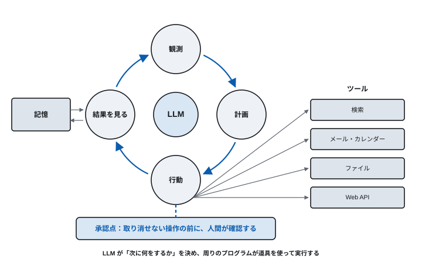
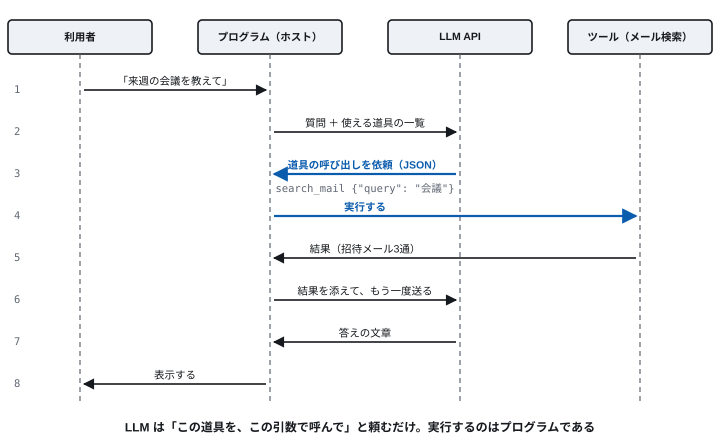
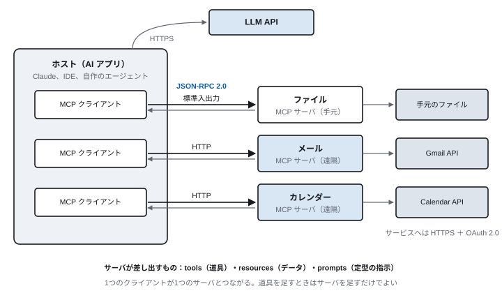
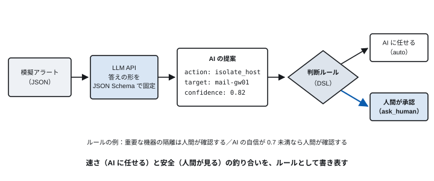

<!-- 通信工学通論　第7回 AIエージェントと MCP -->
<!-- slides/decks/lec07.js から node slides/tools/build-md.js で書き出したもの。
     pptx 版・HTML 版と同じ内容。直すときは decks の側を直して書き出し直す。 -->

<!-- _class: lead -->

通信工学通論

# 第7回　AIエージェントと MCP

*AIエージェントは、ネットワークの上で何をしているのか。何を任せてよいのか。*

九州大学

---

<!-- _class: lead -->

## 今回の問い

> **AIエージェントは、  
ネットワークの上で何をしているのか。**

第2〜6回で学んだ DNS・メール・HTTP・JSON・OAuth・LLM API が、そのまま使われている。

この90分で、この問いに答えを出す。

---

## 到達目標

1. **AIエージェントの動作ループ** と、それを形作る部品を説明できる
2. **ツール呼び出し** で、LLM とプログラムがそれぞれ何をしているかを説明できる
3. **MCP と A2A** が何と何をつなぐプロトコルかを説明できる
4. **エージェントの通信** を、これまで学んだプロトコルに分解できる
5. **AI に任せる判断と人間が承認する判断** を、ルールとして書き分けられる

---

<!-- _class: lead -->

# 7.1　AIエージェントとは

*答えるだけでなく、行動する*

---

<!-- 7.1　エージェント -->

## AIエージェントとは何か

- **目的を与えると、自分で動く** — 情報を集め、判断の候補を出し、人の承認を得て、実行する
- **複数の道具を使う** — 検索、メール、カレンダー、ファイル、Web API
- **続けて仕事をする** — 結果を見て次を決め、目標に届くまで繰り返す

> **例：脆弱性への対応**  
> 脆弱性の情報を集め、自分たちが影響を受けるかを調べ、チケットを起票し、修正案を作る。人間は結果を評価して決める。

---

<!-- 7.1　エージェント -->

## エージェントの動作ループ

目標を与えると、自分で手順を決め、道具を使い、結果を見て次を決める。これを目標に届くまで繰り返す。



---

<!-- 7.1　エージェント -->

## エージェントを形作るもの

| 部品 | 役割 |
| --- | --- |
| LLM | 次に何をするかを決める（第6回） |
| ツール | 実際に何かをする手段（Web API、検索、ファイル操作、メールの送信） |
| 記憶 | これまでの経過や、前回までの結果 |
| 指示・手順書 | 目的、やってよいこと、気をつける点（system の文や、手順書のファイル） |
| 実行するプログラム（ホスト） | LLM API を呼び、道具を実行し、結果を LLM に戻す。人間への確認もここで行う |

> **LLM は「頭」にすぎない。手足を動かし、止めるのは周りのプログラムである**

---

<!-- _class: lead -->

# 7.2　ツール呼び出し

*LLM は頼むだけ、実行はプログラム*

---

<!-- 7.2　ツール呼び出し -->

## ツール呼び出しの流れ



---

<!-- 7.2　ツール呼び出し -->

## ツール呼び出しのやりとり（JSON）

### 要求に、使える道具の説明を付ける

```
"tools": [{
  "type": "function",
  "function": {
    "name": "search_mail",
    "description": "受信箱を検索する",
    "parameters": {
      "type": "object",
      "properties": {
        "query": {"type": "string"}},
      "required": ["query"]}}}]
```

### LLM の答え：「これを呼んで」

```
"message": {
  "role": "assistant",
  "tool_calls": [{
    "id": "call_1",
    "type": "function",
    "function": {
      "name": "search_mail",
      "arguments": "{\"query\": \"会議\"}"
    }}]}
```

**LLM は道具を実行しない。名前と引数を JSON で返すだけである（Chat Completions API の形。一部を省略）。**

---

<!-- 7.2　ツール呼び出し -->

## なぜ LLM に直接実行させないのか

> **実行する前に、プログラムが確かめ、止められる**

- 引数がおかしい → **実行しない**
- 取り消せない操作 → **人間に確認する**
- 許されていない道具 → **そもそも渡さない**

第6回の構造化出力と同じく、答えの形が決まっているから、プログラムが確実に読んで判断できる。  
第8回で扱うプロンプトインジェクションへの備えも、ここに入れる。

---

<!-- _class: lead -->

# 7.3　MCP と A2A

*エージェントをつなぐ共通の約束*

---

<!-- 7.3　MCP -->

## MCP：エージェントと道具をつなぐ共通の約束

Model Context Protocol。2024年に Anthropic が公開し、2025年に Linux Foundation の下の団体へ移された。道具ごとに作り込まず、同じ約束で何でもつなげる。



---

<!-- 7.3　MCP -->

## MCP のメッセージは JSON-RPC 2.0

道具の一覧は tools/list、呼び出しは tools/call。手元のサーバとは標準入出力、遠隔のサーバとは HTTP で、この JSON をやりとりする。

### 要求（クライアント → サーバ）

```
{"jsonrpc": "2.0", "id": 7,
 "method": "tools/call",
 "params": {
   "name": "search_mail",
   "arguments": {"query": "会議"}
 }}
```

### 応答（サーバ → クライアント）

```
{"jsonrpc": "2.0", "id": 7,
 "result": {
   "content": [{
     "type": "text",
     "text": "招待メール3通: …"
   }]
 }}
```

**id で要求と応答を対応づける。HTTP の要求と応答の関係を、JSON の中で表したものである。**

---

<!-- 7.3　MCP -->

## デモ：MCP サーバを作る

```
from mcp.server.fastmcp import FastMCP

mcp = FastMCP("demo")

@mcp.tool()
def add(a: int, b: int) -> int:
    """2つの数を足す"""
    return a + b

if __name__ == "__main__":
    mcp.run()        # 標準入出力で待つ
```

**見るところ**

関数を書くだけで、道具になる。名前・説明・引数の型が、tools/list の答えとしてエージェントに伝わる。

説明の文（docstring）は、LLM が「いつこの道具を使うか」を決める手がかりになる。

Claude Desktop などのホストに登録すると、会話から呼べるようになる。

MCP の公式 Python SDK（pip install mcp）を使う例。版によって書き方が変わることがある。

---

<!-- 7.3　MCP と A2A -->

## エージェントをつなぐ2つのプロトコル

|  | MCP | A2A |
| --- | --- | --- |
| つなぐもの | エージェント ⇔ 道具・データ | エージェント ⇔ エージェント |
| 公開 | 2024年（Anthropic） | 2025年（Google） |
| 相手を知る方法 | tools/list で道具の一覧を得る | Agent Card（自己紹介の JSON）を読む |
| 運ぶもの | JSON-RPC 2.0（標準入出力か HTTP） | JSON-RPC 2.0 を HTTP で。経過は SSE で |
| いまの管理 | Linux Foundation の下の団体 | Linux Foundation |

> **どちらも HTTP と JSON の上に作られた、アプリケーション層のプロトコルである**

仕様は改訂が続いている。最新の版は公式サイトで確認すること。

---

<!-- _class: lead -->

# 7.4　事例：会議の招待を拾う

*第2回の問いへの答え*

---

<!-- 7.4　事例 -->

## 会議の招待をメールから拾うエージェント

1日150通のメールから会議の招待だけを拾い、カレンダーに入れる（講師が毎日使っているもの）。

| 通信 | 使われているもの | 学んだ回 |
| --- | --- | --- |
| エージェント → LLM | HTTPS の POST と JSON、SSE | 第3・4・6回 |
| エージェント → Gmail・Slack・カレンダー | MCP（コネクタ）→ 各サービスの Web API | 第4回・今回 |
| サービスを使ってよいという許可 | OAuth 2.0 | 第4回 |
| 会議の招待そのもの | 電子メール（MIME、カレンダー形式の添付） | 第2回 |
| 名前の解決と通信の保護 | DNS、TLS | 第2・3回 |

> **エージェントは、アプリケーション層の新しい使い手である**

---

<!-- 7.4　事例 -->

## 手順書に書いたのは「失敗しやすい所」

このエージェントにはプログラムが1行もない。日本語の手順書（SKILL.md）を書いただけである。中身は、新人への引き継ぎメモと同じ。

- **勝手に登録させない** — 予定の作成は取り消しにくい操作。候補を一覧で見せ、同意を得てから登録する
- **他人にメールを送らせない** — 参加者欄は空にする。これは本人の備忘録であって、招待状ではない
- **罠を先に教える** — Zoom の通知メールの日時欄は、通知した日ではなく開催日を指す
- **迷ったら登録しない** — 誤って登録するより、取りこぼすほうが後から直しやすい

**どこまで任せ、どこで人間が確認するか —— これが次の実習の問いである。**

---

<!-- _class: lead -->

# 7.5　実習：どこまで AI に任せるか

*作業は AI、判断は人*

---

<!-- 7.5　判断の設計 -->

## 作業は AI、判断は人

AI が業務を担い始めると、人間の役割は「作業する人」から「判断を設計する人」に変わる。

> **AI に何を見せ、何を任せ、どこで人が承認するかを、あらかじめ決めておく**

- 調査・分析・下書き → **AI に任せる**
- 取り消せない操作 → **人間が承認する**
- 結果への責任 → **人間が負う**

すべてを AI に任せると速いが、誤った判断で業務を止めうる。すべてを人間が確認すると安全だが遅く、  
担当者が承認に追われる。その間に線を引くのが、この実習である。

---

<!-- 7.5　実習 -->

## 実習：インシデント対応エージェント

教材は theme12-seminar。架空のアラート（不審なログインなど）を LLM に読ませ、最初に取るべき対応を JSON で提案させる。



---

<!-- 7.5　実習 -->

## 答えの形を JSON Schema で決める

code/s1_agent.py から抜粋（一部を省略）。第6回の ask_json を、そのまま使っている。

```
SCHEMA = {
  "type": "object",
  "properties": {
    "verdict":  {"enum": ["true_positive",
                 "false_positive", "uncertain"]},
    "action":   {"enum": ["no_action", "monitor",
                 "block_ip", "disable_account",
                 "isolate_host", "escalate"]},
    "target":     {"type": "string"},
    "confidence": {"type": "number"},
    "reason":     {"type": "string"},
  }, ...
}
```

**なぜ形を決めるのか**

LLM の答えをプログラムで扱うため。自由な文章では、どの対応を選んだのかを確実に読み取れない。

選択肢を enum で限ると、LLM はこの中からしか選ばない。

どの対応にも副作用がある。isolate_host は、その機器を使う業務を止める。

---

<!-- 7.5　実習 -->

## 人間を呼ぶ条件をルールに書く

rules/example.yaml（判断 DSL）。これを写して、自分のルールを作る。

```
rules:
  - name: 重要な機器の隔離は人間が確認する
    if: {action: isolate_host, asset.importance: 高}
    then: ask_human
  - name: AIの自信が低いときは人間が確認する
    if: {confidence: "< 0.7"}
    then: ask_human
  - name: すぐ元に戻せる対応はAIに任せる
    if: {action: [no_action, monitor, block_ip]}
    then: auto
default: ask_human
```

**ルールの読み方**

上から順に調べ、最初に当てはまったものを使う。

auto は AI に任せる、ask_human は人間が承認する。

どれにも当てはまらなければ default に従う。ここでは、迷ったら人間に回す。

---

<!-- 7.5　実習 -->

## 3つの運用を比べる

| 条件 | 内容 | ルールのファイル |
| --- | --- | --- |
| 人間中心 | AI は提案するだけ。すべての対応を人間が承認する | rules/human_centered.yaml |
| 完全委譲 | AI がすべて自分で決めて実行する | rules/full_delegation.yaml |
| 判断 DSL | ルールに当てはまるときだけ、人間が判断する | 自分で書いたルール |

> **自分が承認者になって、同じアラートを3つの条件で処理する**

実行される対応は記録上のシミュレーションで、実際の機器は操作しない。

---

<!-- 7.5　実習 -->

## 実習の手順（30分）

1. **提案させる** — python s1_agent.py で、全アラートへの提案と理由を読む
2. **揺れを見る** — --repeat 3 を付け、同じアラートで答えが変わるか確かめる
3. **ルールを書く** — example.yaml を写し、人間を呼ぶ条件を自分で決める
4. **3条件で動かす** — python s2_run.py rules/…yaml で、承認者として比べる

比べること：人間が承認した回数、かかった時間、誤った隔離が起きたか。  
速さと安全のどこに線を引いたかを、理由とともに説明できるようにする。

---

<!-- 7.5　判断の設計 -->

## リスクは「賢さ」より「権限」にある

エージェントを使う前に、決めておくこと。

- **何を読ませるか** — 信頼できない入力（外から届くメールや Web ページ）が混ざっていないか
- **どこに接続させるか** — メール、ファイル、チャット、クラウド、社内システム
- **何を実行させるか** — 送信・変更・削除・公開・発注
- **どこで人が承認するか** — 外部への送信、本番環境の変更、顧客への連絡、支払い
- **何を記録するか** — AI が何を見て、何をしたかを、後から追えるか

**最小権限・承認点・記録は、人間の新人に対するのと同じである。  
読ませたものに指示が仕込まれていたら？ —— 第8回のプロンプトインジェクションへ。**

---

## 演習

- **7-1**　ツール呼び出しで LLM とプログラムはそれぞれ何を担うか。LLM に道具を直接実行させないことの利点を述べよ。
- **7-2**　MCP と A2A は、それぞれ何と何をつなぐか。どちらもアプリケーション層のプロトコルだと言える理由を述べよ。
- **7-3**　会議の招待を拾うエージェントの通信を、DNS・HTTP・OAuth・メールなど、これまで学んだプロトコルに分解して説明せよ。
- **7-4**　（実習）3つの条件を比べた結果をもとに、自分のルールの ask_human の条件を1つ選び、その線を引いた理由を説明せよ。

---

## まとめ

| 項目 | 要点 |
| --- | --- |
| エージェント | LLM が次の手を決め、プログラムが道具を使って実行する。結果を見て繰り返す |
| ツール呼び出し | LLM は名前と引数を JSON で返すだけ。実行の前に、プログラムが確かめて止められる |
| MCP と A2A | 道具とエージェント、エージェント同士をつなぐ。どちらも HTTP と JSON の上のプロトコル |
| 新しい使い手 | エージェントは、DNS・HTTP・OAuth・メールをそのまま使う、アプリケーション層の使い手である |
| 判断の設計 | 何を任せ、どこで人間が承認するかを決める。リスクは賢さより権限にある |

次回　第8回　セキュリティ：暗号・認証・Web・AI
